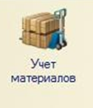

# Test 1
[site](https://offping.github.io/lab.2-GIT/#)



[]( https://offping.github.io/lab.2-GIT/#)

# 1
## 2
### 3
#### 4
##### 5

___

>My README

---

* punkt 1
- punkt 2
+ punkt 3

1. punkt

    * punkt 1
    - punkt 2
    + punkt 3

2. punkt
3. punkt

***

Это просто **пример** для *текста*  
Не оборащайте ***внимания!!***

Тест 1


```
For example testing the MarkDown (.md)
```

Item      | Value | Quantity
:-------- |:-----:| --------:
Computer  |1600   |1
Phone     |12     |2
Tablet    |1      |3
